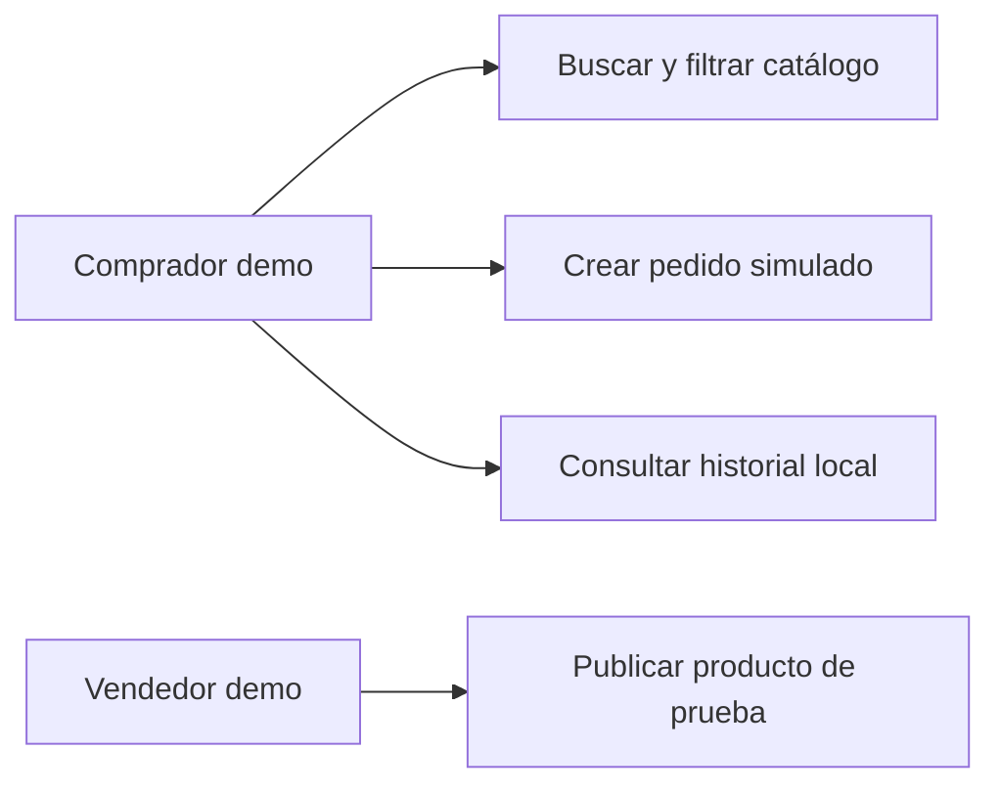
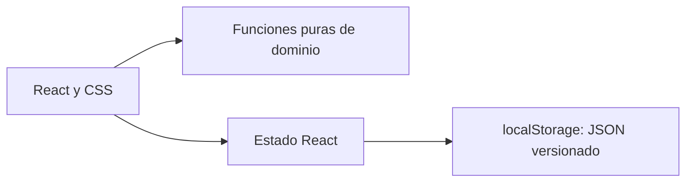
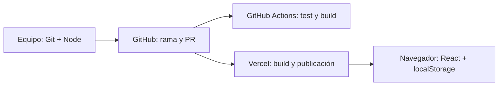
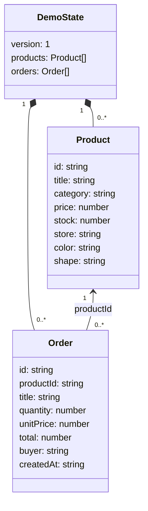

# GYP-5 - Diseño y verificación del simulacro

Responsable: Marcelo Martinez. Fecha real: 16/11/2026 (Lima).
Alcance: demostración académica, sin autenticación ni base remota.

## Casos de uso

Los actores no son roles de acceso. Cualquier visitante de la demo puede
utilizar ambos recorridos en su navegador.

## Arquitectura lógica

`page.tsx` coordina formularios y estado; `domain.ts` valida productos y
pedidos, filtra y resta stock; la escritura local se intenta antes de
confirmar el estado. No hay API de negocio ni autorización del servidor.

## Arquitectura física

La integración de Vercel construye main automáticamente. El workflow de
Actions valida el código; no constituye un bloqueo de despliegue de Vercel
a menos que se configure esa política por separado.

## Modelo implementado (objetos TypeScript, no tablas SQL)

## Verificación real

- `npm test`: 9 pasan, 0 fallan, 0 omitidas.
- `npm run build`: satisfactorio; incluye TypeScript.
- Local: buscar sin tilde, vacío, publicar S/42.50 stock4, pedir2 total85,
  stock2 e historial que sobrevive a recarga. Precio negativo bloqueado.
- Móvil 390x844: formulario visible, sin desbordamiento horizontal.
- Vercel: catálogo público; cantidad25 con stock24 rechazada; pedido2
  a S/29.90 total S/59.80; historial y stock22 conservados tras recarga.

Las pruebas funcionales anteriores se ejecutaron mediante navegador, no
son una suite E2E automatizada. No se probaron pagos ni servicios de datos
porque están fuera del alcance aprobado.

## Sprint Review y refinamiento

Incremento: recorrido completo de catálogo, publicación y pedido local.
Evidencia: PR #1, commits con claves GYP, comentarios de las historias,
URL pública y capturas en el informe individual.

Para una segunda práctica con base real: autenticación, autorización en
servidor, persistencia compartida y operaciones atómicas de stock. Para
reforzar calidad: E2E automatizado y accesibilidad completa de teclado.
No se marcan esas mejoras como implementadas.
